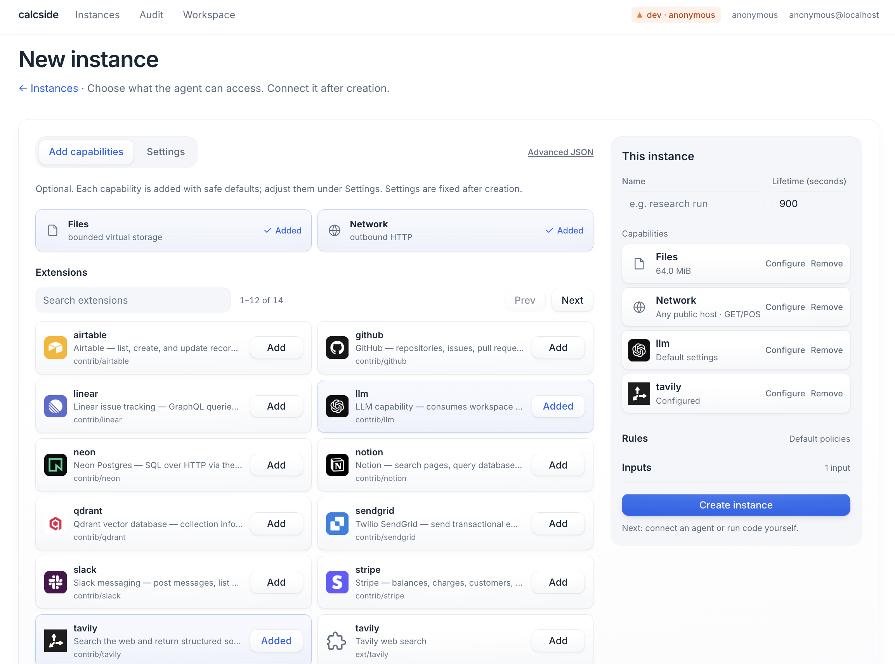

# calcside



A lightweight code-execution sandbox for AI agents, built on Starlark.

## Get started

```bash
./docker/init-env.sh && cd docker && docker compose up --build
```

Then open http://localhost:8080.
