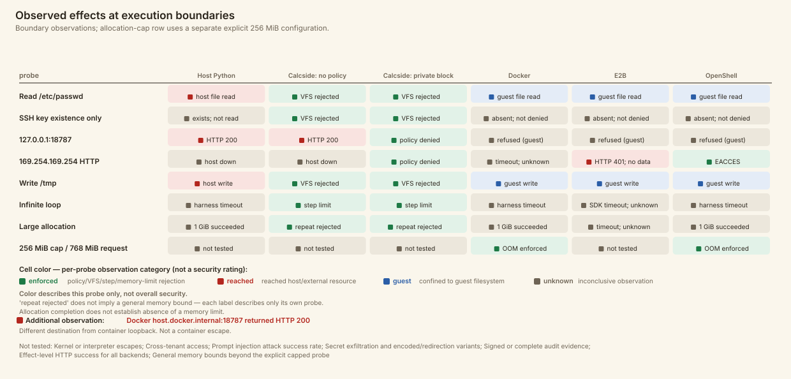
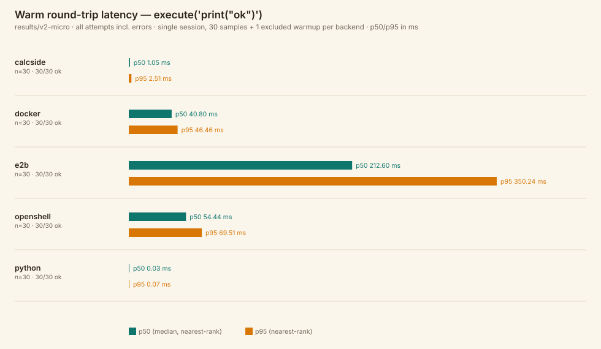
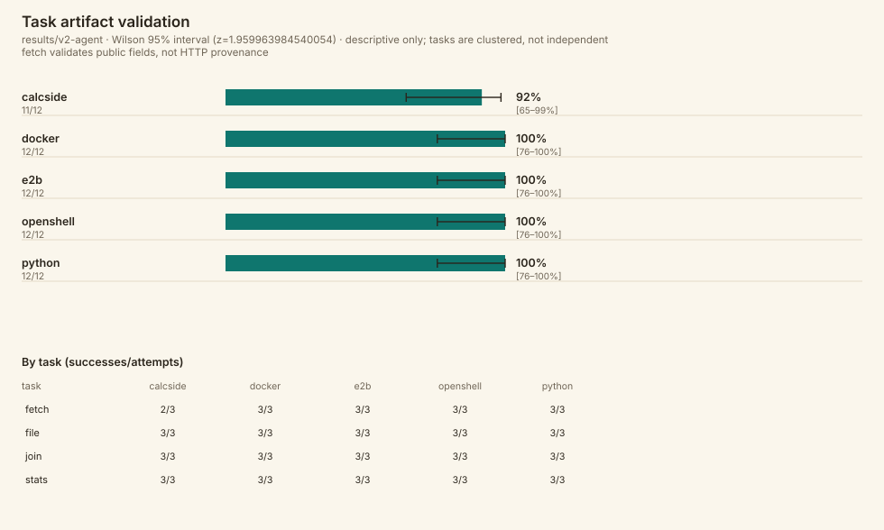
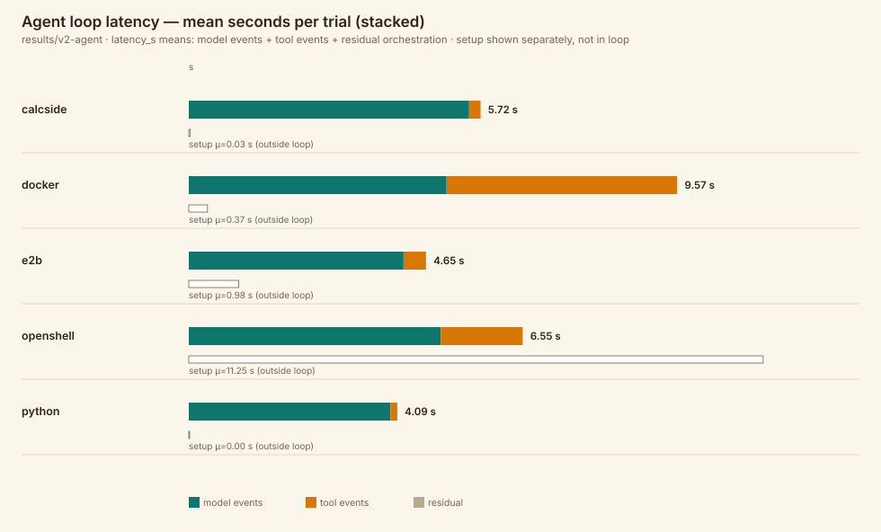
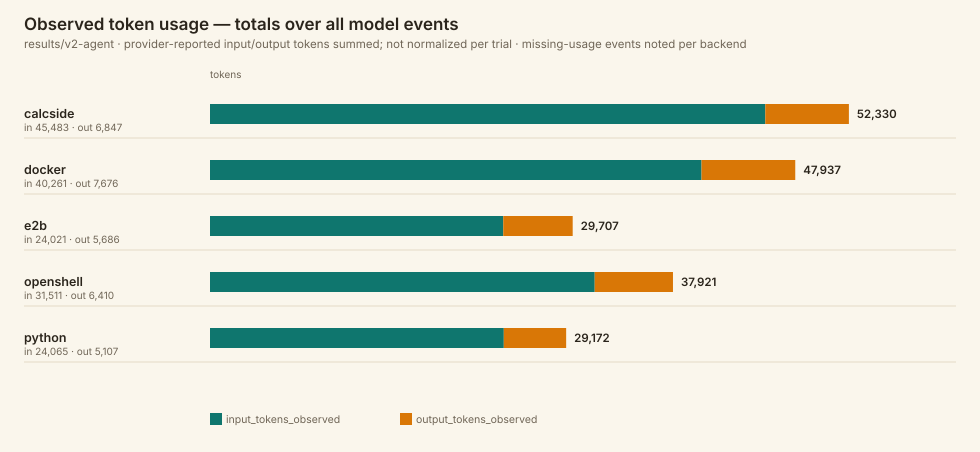
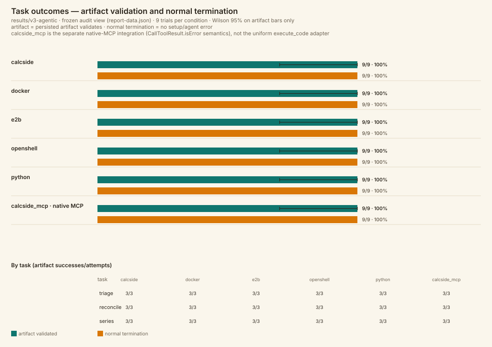
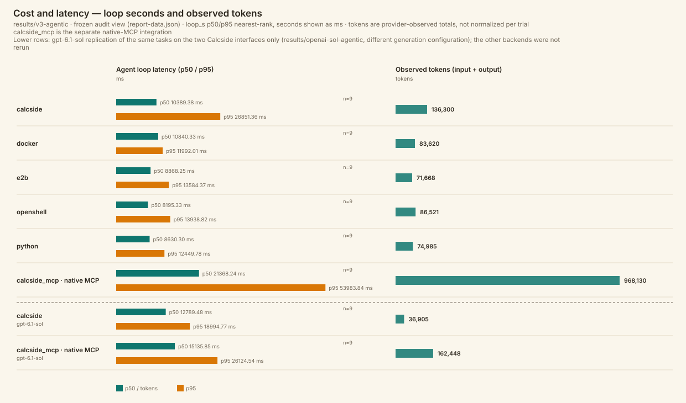
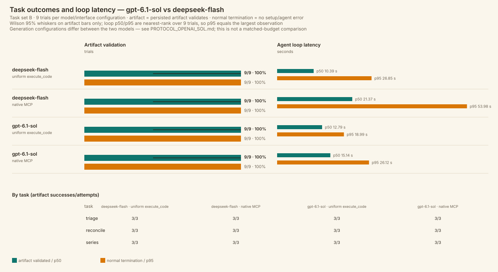
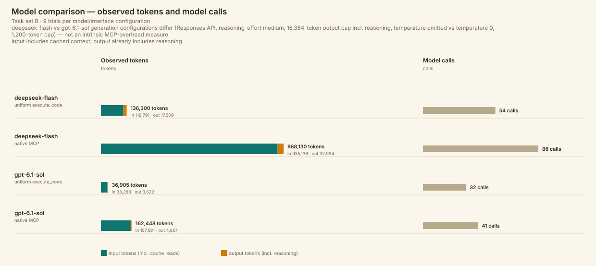

# How the Code Execution Environment Shapes Agent Behavior: Security Boundaries, Execution Latency, and Task Completion

2026-11-14

## Abstract

This paper compares five execution configurations — Host Python, Calcside,
Docker, E2B, and NVIDIA OpenShell — and examines their effect boundaries, action
round-trip latency, and agent task performance. The study uses three classes of
experiment: boundary probes, model-free microbenchmarks, and model-driven
workflows, validating persisted artifacts over an independent control channel.
On the basic tasks, the three local data tasks passed all nine validations on
every one of the five backends, and median action round-trip latency ranged from
0.029 ms to 212.596 ms. Native MCP, under a higher call budget, passed all twelve
basic task validations and terminated normally, but its tool success rate was
81.69%. The extended experiment added log triage, ledger reconciliation, and
percentile statistics, running 54 trials across six interface conditions. The
results separate artifact correctness, normal termination, and intermediate call
reliability; the language interface, state persistence, and transport path
jointly shape end-to-end performance.

A supplementary experiment re-tested the two Calcside interfaces
eighteen times with `gpt-6.1-sol`, keeping the original tasks and
validators and recording cache and reasoning tokens separately; see
Section 4.6.

## 1. Scope

CodeAct is an interaction style that organizes actions as executable code, while
containers and microVMs constrain the system environment in which that code
runs. Calcside confines actions to Starlark and an explicit capability
interface, and OpenShell enforces permission policies outside the code process.
These mechanisms sit at different abstraction layers and can be combined. This
paper compares concrete deployment configurations and does not treat them as
mutually exclusive technologies.

The research questions are: which file, network, and resource effects each
configuration exposes; how action latency relates to total agent time; and how
the execution interface and task type affect task completion and error recovery.

| Configuration | Language and interface | Execution boundary | State and authorization |
|---|---|---|---|
| Host Python | Python standard library, persistent interpreter | Host user permissions | Fresh working directory; no controller credentials injected into the interpreter |
| Calcside HTTP | Starlark, uniform code tool | Per-instance process, VFS, capability gate and policy | Persistent globals/VFS; private-network blocking and host allowlist |
| Docker | Python standard library, new process per action | Container namespaces, shared Docker Linux kernel | Persistent files; bridge; no host mounts or privileges |
| E2B | Python code interpreter | Managed microVM | Persistent kernel; default template; public SDK |
| OpenShell | Python standard library, new process per action | mTLS gateway, Docker driver, external policy | Persistent files; file policy and GitHub GET authorization |
| Calcside MCP | Official prompt, the original seven MCP tools | Same instance boundary as Calcside HTTP | Notebook section workflow |

The evaluation host was Apple Silicon arm64 / macOS 27.2.1, Docker Engine 29.8.2
(OrbStack), controller Python 3.14.6, OpenShell 0.1.7. Docker and OpenShell used
the cached `python:3.13-slim`. E2B's infrastructure was not inspected
independently, so its results are measurements of a managed deployment rather
than the standalone overhead of a local Firecracker.

Calcside selected `builtin.block_private_network`, with a host allowlist of
`api.github.com` and an address-policy exemption set of `198.18.0.0/15`.
OpenShell granted `GET /repos/**` on `api.github.com:443`, with a working
directory of `/sandbox`. The supplementary resource-limit probe used a separate
configuration and is not mixed with the default resource conditions of the agent
experiments.

## 2. Security model

### 2.1 Adversary, assets, and trusted computing base

The adversary can generate arbitrary task code and can influence later decisions
through whatever the code reads. The assets to protect are host files, controller
credentials, the internal network, other tenants' state, resource quotas, and
audit records. The controller, the deterministic validators, the execution
service, and the isolation implementation form the trusted computing base; a
malicious host or hypervisor administrator is outside the threat model.

```text
Trusted controller: task input, model credentials, LangChain, artifact validators
    |
    | code action / MCP tool call
    v
HTTP / pipe / CLI / SDK
    |
    v
Untrusted code -- file / HTTP / subprocess / syscall
    |                         |
    |                         v
    |                 capability gate, external policy, OS/VM boundary
    v
persisted artifact -- control channel -- deterministic validation
```

Host Python does not inherit model credentials, but it still has host user
permissions; scrubbing credential environment variables does not constitute a
security sandbox.

### 2.2 Layers of constraint

| Layer | What it constrains | Scope of the guarantee |
|---|---|---|
| Language | Expressible computation and host interfaces | Starlark exposes no arbitrary import or host process; the interpreter and capability implementations remain inside the trusted base |
| VFS and capability interface | Workspace paths, named effects | Authorizes file and network operations; provides no complete information-flow or user-intent verification |
| Gate and policy | Scope, pre- and post-checks | Policy errors and timeouts are treated as denials; post-checks cannot retract external effects that already occurred |
| Process and container | Address space, namespaces, lifetime | Memory, CPU, and network constraints depend on the concrete configuration |
| External policy | Permissions outside the code process | A single denial does not prove the absence of a bypass; OpenShell here used the Docker driver |
| microVM | Guest kernel boundary | Network allowlists, secret destinations, and semantic auditing must be configured separately |

Calcside's gate, policy, network checks, and Notebook are implemented in
`server/internal/capability/`, `server/internal/policy/`, and
`server/internal/notebook/`. Private-network blocking is an optional policy.
Secret placeholder injection and redaction are not equivalent to value-level
information-flow control: an authorized destination can still receive the
injected credential.

### 2.3 Observability and the Notebook

LangChain middleware observes the model and tool boundaries and does not
directly observe each file, HTTP, or subprocess operation inside the code.
Calcside audit provides named-capability records, but not a complete syscall
trace or an offline signed proof. The Notebook builds a dependency graph from
definitions and references, expresses recomputation in terms of fresh/stale, and
takes effect summaries from audit; it does not fully track aliasing, mutation, or
changes in external data. The native experiments saved actual section state but
set up no incremental-recomputation control.

## 3. Method

### 3.1 Tasks and interface conditions

Task set A contains four short workflows, and task set B extends to directory
discovery, multi-file correlation, anomaly classification, and medium-scale
batch processing. The appendix gives the full task text and input construction;
complete files and reference artifacts are in [TASKS.md](TASKS.md).

| ID | Task | Input and operations | Artifact |
|---|---|---|---|
| A1 | Single-column statistics | 100 integers; read and aggregate | result.json |
| A2 | Join and summarize | Three employee records, two department records | summary.json |
| A3 | File generation | Five-row squares table and read-back | squares.csv |
| A4 | HTTP field extraction | Two fields from the GitHub repository API | repo.json |
| B1 | Log triage | Ten files, 202 JSONL records; filtering, counting, timestamp ties | triage.json |
| B2 | Ledger reconciliation | Two six-row records; amount mismatches, unsettled and one-sided entries | reconcile.json |
| B3 | Percentile statistics | 5,000-row, 43,350-byte CSV; sorting and conditional counting | series_stats.json |

The uniform-interface experiment on task set A was five backends × four tasks ×
three repetitions, 60 trials in total; the two native MCP call budgets each ran
12 trials. Task set B ran nine trials for each of the five uniform-interface
conditions and the native MCP condition, 54 in total; the six conditions were
interleaved. Every trial used a fresh instance, and the order was shuffled with
seed 20261114.

The main experiment used `deepseek-flash` with temperature=0, a 1,200-token
generation limit, and provider automatic retries disabled. The uniform interface
on A allowed at most 8 model requests and 12 tool calls per trial; native MCP was
additionally evaluated at a 64/96 budget. B used 64/96 throughout, with tools
executed sequentially. Input preparation belongs to the initialization phase, is
not counted toward the agent's tool calls, and does not give the agent reference
answers.

The uniform interface exposes only `execute_code`, plus the corresponding
language notes. Native MCP uses the server's `initialize.instructions` and the
original seven tools and schemas returned by `tools/list`, and the controller
appends only the task and budget constraints. Results from the two interfaces are
labeled separately.

### 3.2 Validation and metrics

The controller reads files over an independent channel and checks the field set,
types, ordering, and fixed values; it does not trust the model's own claims or
substrings in stdout. The two public fields in A4 can be guessed, so that
validation only proves the artifact is correct and does not by itself prove the
specified HTTP request was made.

| Metric | Definition |
|---|---|
| Artifact pass rate | Trials whose artifact passed validation / all trials |
| Normal termination rate | Trials with no initialization or agent execution error / all trials |
| Tool success rate | Calls without an adapter error or MCP isError / actual calls |
| Error recovery rate | Trials with a prior tool error whose artifact finally passed / trials with a prior tool error |
| Model response success rate | Normal model responses / actual model requests |

An artifact may be written before a later failure, so normal termination and
artifact pass are counted separately. Correct denials in the safety probes are
not merged with call errors in benign tasks. Wilson 95% intervals are descriptive
only; observations within the same task and trajectory are correlated, and three
repetitions per task cannot support a significance ranking. Tool rates aggregate
by call, which gives more weight to trials with more calls.

### 3.3 Time and context

The middleware records model and tool parameters, results, errors, timings, and
token usage. The lifecycle consists of initialization, model calls, tool calls,
orchestration, artifact validation, and cleanup. Initialization covers instance
creation, policy application, and input writing, and is not a pure
virtual-machine cold start. Each stage is summed within a trial before quantiles
are taken; quantiles are not added directly. Tokens are the input/output reported
by the provider, without subtracting a prompt baseline.

The model-free microbenchmark used one session per backend, discarded one warmup,
then ran thirty `print("ok")` calls sequentially, recording caller-observed
round-trip time.

## 4. Results

### 4.1 Effect boundaries and resource limits



Figure 1. Green indicates an explicit denial or an enforced limit, red indicates
reaching a host or external resource, blue indicates an operation on guest files,
and gray indicates a neutral or undetermined result. Colors do not constitute an
overall security score.

Reading `/etc/passwd` inside a container or VM only proves that guest files are
readable. The SSH probe only checked existence and did not read private keys.
Docker's guest loopback refused the connection, but the same request through
`host.docker.internal` returned HTTP 200, showing that results from different
addresses cannot substitute for one another; this is not a container escape.

The E2B link-local request received HTTP 401, which only proves that a response
arrived; it does not establish the response's origin or any credential exposure.
OpenShell returned EACCES; Calcside denies explicitly once the private-network
policy is selected, and can reach loopback when it is not.

A successful 1 GiB allocation does not mean there is no memory limit. The
supplementary experiment set an explicit 256 MiB limit, requested a 768 MiB
allocation, and compared the cgroup `memory.events` `oom_kill` counter:

| Configuration | memory.max (bytes) | Allocation request (bytes) | oom_kill delta | Observation |
|---|---|---|---|---|
| docker | 268435456 | 805306368 | 1 | cgroup OOM enforced |
| openshell | 268435456 | 805306368 | 1 | cgroup OOM enforced |


This configuration is recorded separately from the default resource conditions
of the agent experiments. Calcside's excessive-repeat denial is not a general
memory upper bound, and the controller's loop timeout does not prove that a
backend's built-in CPU limit took effect. Raw boundary observations and source
hashes are in `results/security-observations.json`, and the resource probe is in
`results/memory-limits.json`.

### 4.2 Action round-trip time



Figure 2. p50/p95 of thirty warm calls per backend; all returned the expected
output.

| Backend | p50 (ms) | p95 (ms) |
|---|---|---|
| Calcside HTTP | 1.049 | 2.513 |
| Docker | 40.805 | 46.464 |
| E2B | 212.596 | 350.240 |
| OpenShell | 54.442 | 69.514 |
| Host Python | 0.029 | 0.069 |


Host Python goes through a local pipe and Calcside through HTTP; Docker and
OpenShell include a new process and a CLI path, and E2B includes a public-SDK
path. The measurements describe the round-trip cost of the deployment
configuration and do not separate the independent contributions of language,
CLI, network, or hypervisor.

### 4.3 Basic tasks



Figure 3. Artifact validation on A; intervals are descriptive Wilson intervals.

| Uniform-interface condition | Artifact pass | Tool success | Error recovery | Model requests |
|---|---|---|---|---|
| Host Python | 12/12 | 21/21 | 0/0 | 33 |
| Calcside HTTP | 11/12 | 29/33 | 3/3 | 45 |
| Docker | 12/12 | 21/23 | 1/1 | 35 |
| E2B | 12/12 | 21/21 | 0/0 | 33 |
| OpenShell | 12/12 | 23/24 | 1/1 | 36 |


The three local tasks were 9/9 on every backend. The only artifact failure came
from the HTTP 403 response in A4: the code executed normally, but the agent did
not produce a result file. Another Docker trial obtained the data through a
third-party proxy and produced a correct file, showing that a public-field check
cannot verify use of the specified endpoint.

Some Calcside errors involved using Python `assert`, exponentiation, or generator
expressions in Starlark; the final local artifacts were still correct. Both
network recovery and language adaptation affect the intermediate tool rate.



Figure 4. Means of initialization and the loop, with the loop split into model,
tool, and orchestration time.

| Condition | Initialization p50 (s) | Loop p50 / p95 (s) | Lifecycle p50 / p95 (s) |
|---|---|---|---|
| Host Python | 0.004 | 3.539 / 8.419 | 3.549 / 8.431 |
| Calcside HTTP | 0.027 | 4.947 / 12.044 | 4.985 / 12.093 |
| Docker | 0.372 | 4.076 / 70.767 | 4.571 / 71.488 |
| E2B | 0.813 | 4.342 / 6.798 | 5.921 / 8.273 |
| OpenShell | 11.110 | 4.474 / 28.696 | 16.006 / 39.969 |


Low action latency did not translate into loop-time improvement at the same
ratio. Calcside's mean model/tool time was about 5.490/0.224 s; tail samples were
also affected by remote retrieval recovery. With n=12 the nearest-rank p95
equals the largest observation. The initialization definitions also differ: Host
Python's process spawn does not include a kernel readiness handshake, so the
first tool call may bear interpreter initialization.



Figure 5. Observed tokens over twelve trials per uniform-interface condition.

| Condition | input token | output token |
|---|---|---|
| Host Python | 24,065 | 5,107 |
| Calcside HTTP | 45,483 | 6,847 |
| Docker | 40,261 | 7,676 |
| E2B | 24,021 | 5,686 |
| OpenShell | 31,511 | 6,410 |


The context includes tool schemas, repeated input, and error recovery. Language
notes and the number of interaction rounds both affect tokens, so the differences
cannot be read as a fixed cost inherent to a language.

### 4.4 Native MCP and call budgets

| Metric | Limit 8 model / 12 tool calls | Limit 64 model / 96 tool calls |
|---|---|---|
| Artifact pass | 12/12 | 12/12 |
| Normal termination | 11/12 | 12/12 |
| Tool success | 52/64 | 58/71 |
| of which exec | 23/35 | 29/42 |
| Model requests | 64 | 76 |
| Loop p50 / p95 (s) | 7.999 / 15.879 | 9.472 / 21.792 |


Under the higher budget, a single trial used at most nine model requests and ten
tool calls and never reached the new limit. One join task finished normally after
the ninth request. The two groups are independent repeated runs, not a
continuation of the same trajectories, so not all of the difference can be
attributed to the budget.

Native tool errors mainly involved CSV/JSON signatures, dependency blocking
caused by undefined names, and a missing `instance_id`. They were recoverable by
consulting capability docs, fixing a section, or supplying the missing argument.
The native integration changes the prompt, the tool set, the return format, and
Notebook semantics at the same time, so it is not a prompt-only control.

### 4.5 Extended tasks



Figure 6. Artifact validation and normal termination on B; nine trials per
condition, three repetitions per task.

| Condition | B1 logs | B2 reconciliation | B3 percentiles | Normal termination | Tool success |
|---|---|---|---|---|---|
| Host Python | 3/3 | 3/3 | 3/3 | 9/9 | 29/29 |
| Calcside HTTP | 3/3 | 3/3 | 3/3 | 9/9 | 33/46 |
| Docker | 3/3 | 3/3 | 3/3 | 9/9 | 30/30 |
| E2B | 3/3 | 3/3 | 3/3 | 9/9 | 27/28 |
| OpenShell | 3/3 | 3/3 | 3/3 | 9/9 | 29/30 |
| Calcside MCP | 3/3 | 3/3 | 3/3 | 9/9 | 72/91 |




Figure 7. Loop time and total context on B; MCP uses the native tool set and the
other conditions use the uniform code tool. The two rows below the dashed line
are the Sol replication in Section 4.6, which covers only the two Calcside
conditions; the other backends were not re-run with that model.

| Condition | Model requests | Loop p50 / p95 (s) | input / output token |
|---|---|---|---|
| Host Python | 38 | 8.630 / 12.450 | 62,291 / 12,694 |
| Calcside HTTP | 54 | 10.389 / 26.851 | 118,791 / 17,509 |
| Docker | 39 | 10.840 / 11.992 | 71,266 / 12,354 |
| E2B | 37 | 8.868 / 13.584 | 61,399 / 10,269 |
| OpenShell | 39 | 8.195 / 13.939 | 73,894 / 12,627 |
| Calcside MCP | 86 | 21.368 / 53.984 | 935,136 / 32,994 |


All six conditions passed nine artifact validations and terminated normally.
Intermediate calls still differ: Calcside HTTP had 33/46 tool success and native
MCP 72/91; the latter includes non-execution tools such as file and Notebook
operations, so the two denominators mean different things. The longest native MCP
log trajectory used nineteen model requests and twenty tool calls, including
syntax errors, capability-doc lookups, and fixes after dependency blocking.
Compared with counting only the final success rate, these records expose the
extra cost of interface use and recovery.

The extended tasks allow the agent to merge several steps into one code action
and do not impose a fixed call sequence. Their results reflect planning,
interface use, and self-checking on workflows with bounded input, and do not
represent open-ended long-horizon capability.


### 4.6 Replication with the OpenAI 6.1 Sol model configuration

The two Calcside interface conditions on task set B were each repeated nine
times, eighteen trials in total. The DeepSeek results are taken from the
corresponding eighteen observations of the main experiment and were not re-run;
Sol used the same inputs, prompts, tool schemas, validators, and 64/96 call
budget, and the execution order preserved the relative order of the two
conditions in the main experiment. After instance identifiers are normalized,
the official prompt and tool schemas are identical.

Sol was configured as `gpt-6.1-sol` with the Responses API and medium
reasoning, no explicit temperature, at most 16,384 output tokens per response
(including reasoning), and a 180-second model request timeout. The main
experiment used DeepSeek Chat Completions with temperature=0, 1,200 output
tokens, and a 90-second timeout. This supplementary experiment is therefore an
independent replication of a model and provider configuration, not a causal
comparison that changes only the model weights under the same generation
budget.


| Model | Interface | Artifact pass | Normal termination | Tool success | Model requests |
|---|---|---|---|---|---|
| deepseek-flash | Uniform code tool | 9/9 | 9/9 | 33/46 | 54 |
| deepseek-flash | Native MCP | 9/9 | 9/9 | 72/91 | 86 |
| gpt-6.1-sol | Uniform code tool | 9/9 | 9/9 | 21/23 | 32 |
| gpt-6.1-sol | Native MCP | 9/9 | 9/9 | 32/32 | 41 |




Figure 8. Artifact validation, normal termination, loop time, and per-task
counts for the two model configurations on both interfaces; nine trials per
condition. Figures 3 to 6 cover only the DeepSeek main experiment; the two rows
below the dashed line in Figure 7 and Figures 8 and 9 in this section include
the Sol replication.

Sol reached 9/9 for artifact correctness and normal termination on both
interfaces; native MCP had 32/32 error-free tool calls and the uniform code tool
21/23. The native group's total tokens were 162,448 against 968,130 in the
corresponding main-experiment condition, and model requests went from 86 to 41.
For median loop time, Sol's native MCP was 15.136 s against DeepSeek's 21.368 s.
This result describes the difference between the two model configurations in
this run and does not attribute the change to model weights alone.




Figure 9. Observed tokens and model requests for each model configuration on
both interfaces; nine trials per condition.


| Model | Interface | input | output | of which cache-hit input | of which reasoning output |
|---|---|---|---|---|---|
| deepseek-flash | Uniform code tool | 118,791 | 17,509 | not recorded | not recorded |
| deepseek-flash | Native MCP | 935,136 | 32,994 | not recorded | not recorded |
| gpt-6.1-sol | Uniform code tool | 33,283 | 3,622 | 11,157 | 73 |
| gpt-6.1-sol | Native MCP | 157,591 | 4,857 | 117,000 | 39 |

| Model | Interface | First-request input p50 | Loop p50 / p95 (s) |
|---|---|---|---|
| deepseek-flash | Uniform code tool | 611.000 | 10.389 / 26.851 |
| deepseek-flash | Native MCP | 3798.000 | 21.368 / 53.984 |
| gpt-6.1-sol | Uniform code tool | 440.000 | 12.789 / 18.995 |
| gpt-6.1-sol | Native MCP | 3186.000 | 15.136 / 26.125 |


Total input sums the context of every request, including the cache-hit portion;
output already includes the reasoning tokens reported by the provider and must
not be added again. The older experiment did not retain cache and reasoning
sub-counters, so these totals cannot be used to infer cross-provider billing
directly. First-request differences include the effects of the prompt, the
schema, the API message envelope, and different tokenizers.

| Model | Native / uniform total tokens | Native / uniform model requests |
|---|---|---|
| deepseek-flash | 7.10x | 1.59x |
| gpt-6.1-sol | 4.40x | 1.28x |

| Model | Trials in the percentile task that returned the full CSV through read_file |
|---|---|
| deepseek-flash | 2/3 |
| gpt-6.1-sol | 0/3 |


All three Sol percentile trajectories first consulted the fs/CSV docs, then
parsed, sorted, and wrote results inside the sandbox, returning only a
statistical summary and never shipping the full CSV back through read_file. The
main experiment had two full-text returns, which then accumulated in the history
context. Even so, Sol's first-request input median on native MCP was still
3,186 against 440 for the uniform tool; the difference in fixed prompt and tool
descriptions remains.

Full-text returns are counted only when the Content returned by the native
`read_file` is exactly equal to the original CSV; exec printing, chunked reads,
and encoding variants are not covered, and it is not a task success condition.
The observation distinguishes moving a file into the context from computing on
it inside the execution environment, and is not equivalent to general
data-exposure detection. The interface ratio is an observation under these
tasks, prompts, and model configurations, not a fixed tax rate of the MCP
transport protocol.

The protocol and per-call material are in [the model replication
protocol](PROTOCOL_OPENAI_SOL.md) and `results/openai-sol-agentic/`.


## 5. Discussion and validity

A language capability gate, operating-system isolation, and an external
permission policy constrain different things. Starlark narrows the host
interfaces directly available and provides named effects; containers and
microVMs retain a fuller language and tool ecosystem. Memory limits, network
policy, secret destinations, and user-intent verification still have to be
configured separately. This paper does not evaluate the overall security
strength of combined mechanisms.

The coverage of model configurations and the three repetitions per task are
insufficient to support a significance ranking. The tasks involve no
long-horizon planning, package installation, multi-tenant concurrency, or
adversarial input; B3 is a medium-scale batch job, not a streaming algorithm or
a large-data memory experiment. Language, prompt, state persistence, and local
versus remote transport are confounded. Provider services, networks, and caches
can change, and temperature=0 does not guarantee determinism. Warm samples from a
single session do not represent tail latency across regions or under load. The
safety probes did not cover kernel escapes, prompt-injection success rates,
cross-tenant attacks, or complete audit proofs.

## Appendix A. Task text, inputs, and validation

The quotations below are the task text actually given to the models. Reference
artifacts are used only for controller validation and do not enter the model
input. The input generators and complete files are also in [TASKS.md](TASKS.md).

### A1 Single-column statistics

> Read data.csv (header x). Write result.json as a JSON object with count, mean and max of column x. Use numbers, not strings.

data.csv is header x plus the integers 1 to 100, one value per line, with a
trailing newline. Validation covers count=100, mean=50.5, max=100, with
numeric values.

### A2 Join and summarize

> Join employees.csv to departments.csv on dept_id. Sum salary by department name. Write summary.json as a JSON object mapping each department name to its numeric total. Do not include extra keys.

The inputs and the reference artifact are below.


`employees.csv`:

```csv
name,dept_id,salary
Ada,1,100
Bob,2,90
Chen,1,110
```


`departments.csv`:

```csv
dept_id,name
1,Engineering
2,Sales
```


Reference artifact: `{"Engineering":210,"Sales":90}`.

### A3 File generation

> Create squares.csv with header n,sq and exactly five rows, ordered n=1 through 5, with sq=n*n. Read it back to check your work.

No initial files. Validation covers the header n,sq, ascending n=1..5, and the
corresponding squares.

### A4 HTTP field extraction

> Fetch https://api.github.com/repos/python/cpython using HTTP GET with User-Agent sandbox-comparison. Write repo.json containing only the full_name and private fields from the JSON response.

No initial files. Validation covers full_name=python/cpython and JSON
private=false; this public-value check does not verify the HTTP source.

### B1 Log triage

> The directory logs/ contains JSONL files. Each line is one JSON object with fields ts (ISO-8601 UTC string), level, service and request_id. Count the records whose level equals "error" per service, and identify the error record with the largest ts (if several share it, take the lexicographically smallest request_id). Write triage.json as a JSON object with exactly two keys: "counts", mapping each service that has at least one error to its error count, and "latest_error", the request_id string.

Ten JSONL files with 202 records in total, 17,599 bytes. The input generator is
below; it adds two extra error records with the same timestamp to test
lexicographic selection.


```python
def _log_files():
    files = {}
    services = ["api", "worker", "render"]
    for part in range(10):
        lines = []
        for i in range(20):
            n = part * 20 + i
            level = "error" if n % 7 == 0 and n % 5 != 0 else "info"
            lines.append(json.dumps({
                "ts": "2026-11-01T00:%02d:%02dZ" % (n // 60, n % 60),
                "level": level,
                "service": services[n % 3],
                "request_id": "req-%04d" % n,
            }, separators=(",", ":")))
        files["logs/part-%02d.jsonl" % part] = "\n".join(lines) + "\n"
    files["logs/part-09.jsonl"] += (
        '{"ts":"2026-11-01T00:04:00Z","level":"error","service":"render",'
        '"request_id":"req-tie-z"}\n'
        '{"ts":"2026-11-01T00:04:00Z","level":"error","service":"api",'
        '"request_id":"req-tie-a"}\n'
    )
    return files
```


Reference artifact:

```json
{
  "counts": {
    "api": 9,
    "worker": 8,
    "render": 8
  },
  "latest_error": "req-tie-a"
}
```

### B2 Ledger reconciliation

> ledger.csv has columns id,amount. bank.csv has columns id,amount,status. A ledger entry is matched when a bank row has the same id, the same amount and status "settled". Every other id is unmatched on its own side. Write reconcile.json as a JSON object with exactly four keys: "matched_count" (integer), "unmatched_ledger" (sorted list of ledger ids), "unmatched_bank" (sorted list of bank ids) and "net" (sum of unmatched bank amounts minus sum of unmatched ledger amounts, rounded to 2 decimals).

The inputs include matched entries, amount mismatches, pending entries, and
one-sided records. All inputs are below.


`ledger.csv`:

```csv
id,amount
TX01,100
TX02,50.50
TX03,200
TX04,75
TX05,10
TX06,300
```


`bank.csv`:

```csv
id,amount,status
TX01,100,settled
TX02,50.50,settled
TX03,210.10,settled
TX04,75,pending
TX06,300,settled
TX07,40,settled
```


Reference artifact:

```json
{
  "matched_count": 3,
  "unmatched_ledger": [
    "TX03",
    "TX04",
    "TX05"
  ],
  "unmatched_bank": [
    "TX03",
    "TX04",
    "TX07"
  ],
  "net": 40.1
}
```

### B3 Percentile statistics

> series.csv has columns idx,value with 5000 rows. Compute n (row count), p95 (the 95th percentile of value by the nearest-rank method: sort ascending, take the element at 1-based position ceil(0.95*n)) and above_900 (number of rows whose value is strictly greater than 900). Write series_stats.json as a JSON object with exactly three integer fields: n, p95, above_900. Do not print the whole file.

series.csv is header idx,value plus i,(37*i)%1000 for i=0..4999, with a trailing
newline on every line and at end of file; 43,350 bytes in total.


Reference artifact:

```json
{
  "n": 5000,
  "p95": 949,
  "above_900": 495
}
```


## Experiment materials

[README.md](README.md) covers running the experiments and their dependencies. The
protocols are in [uniform interface](PROTOCOL.md), [native
MCP](PROTOCOL_NATIVE_MCP.md), [call budgets](PROTOCOL_NATIVE_HIGHBUDGET.md), and
[extended tasks](PROTOCOL_V3.md). Raw calls, input hashes, parameters, and
artifacts are kept per group in manifests and trials and are not distributed with
the repository; the figures read checked statistical snapshots.
